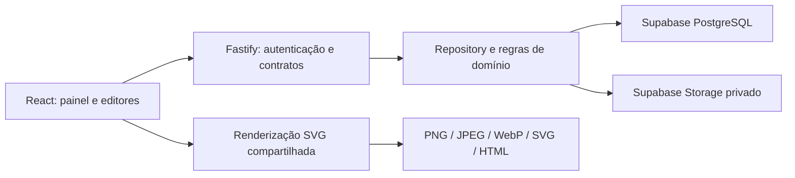

# Diagnóstico, arquitetura e evolução

## Auditoria do projeto anterior

O repositório original tinha uma página de 661 linhas, um editor de 631, um exportador de 676, temas em 206 e CSS em 1069. Não havia package manifest, build, API, banco, autenticação, CI ou testes. A documentação descrevia cinco scripts globais carregados em ordem. A importação aceitava objetos parcialmente validados; o estado não era persistido. O exportador media seletores fixos do DOM e reproduzia texto e ícones em Canvas, dificultando incorporar novos editores.

O README afirmava ausência de CDN, mas `banner.css` importava Google Fonts. A configuração original tinha informações profissionais reais, cores semânticas, QR local, exportação e limites úteis. A validação inicial no Chromium confirmou que edição, temas e exportação funcionavam com fontes locais.

Reaproveitamento: conteúdo inicial, conceito de kit semântico, presets, limites de exportação, geração de QR MIT e fluxo de importação v3. O código original completo e a documentação estão em `legacy/`; o renderer novo incorpora o gerador de QR em módulo. A migração não executa JavaScript nem aceita HTML arbitrário. `**negrito**` legado é convertido em texto e o nome continua destacado; ` ` vira quebra de linha. Campos de exportação antigos não alteram as dimensões do projeto automaticamente.

## Requisitos e prioridades

O MVP entrega gerenciamento persistente de banners, assinaturas e avatars, perfis separados, kit reutilizável, mídia, modelos, edição visual, revisão/recuperação e exportação/backup. As operações devem funcionar com a API real, preservar dados ao reiniciar e rejeitar arquivos, URLs e referências inválidos. Não há necessidade de múltiplos usuários, faturamento, OAuth, filas de renderização ou microserviços para esse uso pessoal.

Integrações automáticas com Gmail/LinkedIn, fontes próprias, novos renderers, camadas livres e colaboração são evoluções, não recursos presentes. O painel gerencia e exporta materiais; não publica nas contas externas.

## Decisões de tecnologia

| Alternativa                  | Avaliação                                                                                                   | Decisão                                                            |
| ---------------------------- | ----------------------------------------------------------------------------------------------------------- | ------------------------------------------------------------------ |
| Manter scripts globais       | Pouco custo inicial, mas forte acoplamento e pouco suporte ao novo domínio                                  | React + TypeScript, componentes e contratos explícitos             |
| Framework full stack com SSR | Mais infraestrutura e complexidade para um editor autenticado sem requisito de SEO                          | Vite e API Fastify                                                 |
| SQLite local                 | Adequado para a primeira hipótese de ambiente pessoal, mas incompatível com persistência na Render gratuita | PostgreSQL do Supabase obrigatório em produção                     |
| Armazenar binários no banco  | Amplifica backups, leitura e consumo da cota relacional                                                     | Supabase Storage privado; só metadados no PostgreSQL               |
| ORM completo                 | Mais dependências para um domínio pequeno, com documentos tipados                                           | SQL parametrizado, repository e migrations versionadas             |
| Reconstruir DOM em Canvas    | Divergência entre preview e saída, seletores fixos                                                          | SVG compartilhado e Canvas apenas para rasterizar                  |
| Dois serviços na Render      | Exige CORS/configuração adicional e mais instâncias sujeitas a suspensão                                    | Um Web Service gratuito para frontend compilado + API              |
| Autenticação multiusuário    | Não exigida no produto pessoal e amplia domínio                                                             | Chave pessoal de alta entropia; futura migração para Supabase Auth |

React organiza estado e componentes; TypeScript evita divergência de contratos; Zod valida dados na API e no editor. PostgreSQL fornece transações e bloqueios de linha; Storage mantém imagens fora do processo. A quantidade de dependências é limitada e suas versões ficam fixadas no lockfile. Node 24 é a versão suportada.

## Módulos

- `client/src`: aplicação, API client, editor, kit, modais e exportação.
- `shared/model.ts`: domínio, validações, contratos e migração do legado; `shared/platforms.ts` mantém o catálogo.
- `shared/render.ts`: escaping, SVG, assinatura HTML e rasterização do SVG. Não depende da API.
- `server/app.ts`: HTTP, chave de acesso, origem, erros e rotas.
- `server/store.ts`: domínio, SQL parametrizado, transações, histórico e backup.
- `server/storage.ts`: adaptadores de armazenamento; disco local restrito a desenvolvimento.
- `server/images.ts`: limites, identificação e normalização de imagens.
- `server/migrations`: migrations PostgreSQL executadas com lock de inicialização.

## Dados e invariantes

O schema `identity_studio` evita interferir em tabelas existentes do Supabase. Tabelas relacionais mantêm IDs, relações e documentos JSONB validados com formato versionado no backup.

| Entidade        | Responsabilidade e relações                                          |
| --------------- | -------------------------------------------------------------------- |
| Profile         | Contexto, nome, descrição e kit de identidade                        |
| Asset           | Perfil, plataforma, conteúdo, cores, layout, tags, favorito e versão |
| Revision        | Snapshot completo do ativo, número único por ativo e data            |
| Template        | Composição personalizada vinculada a um perfil                       |
| Media           | Perfil, nome, MIME, dimensões e ID do objeto; sem binário no banco   |
| Storage cleanup | Fila durável de objetos órfãos a remover                             |

Salvar um ativo bloqueia sua linha, compara a versão recebida, grava a nova versão e o snapshot na mesma transação. Restaurar cria uma nova revisão. Excluir um ativo remove seu histórico; recuperação posterior depende de backup. Imagens referenciadas por kit, ativos, modelos ou histórico não podem ser excluídas isoladamente. Perfis têm exclusão em cascata com confirmação explícita na interface.

Configurações são snapshots independentes. Novos ativos herdam o kit, mas uma mudança no kit não altera trabalhos já aprovados: “Aplicar identidade” é explícito. IDs de imagens precisam pertencer ao mesmo perfil. Modelos internos são globais e recebem o conteúdo do perfil; modelos do usuário ficam no contexto.

## Segurança e consistência

Produção exige chave pessoal, PostgreSQL com TLS verificado e Supabase Storage. O cliente recebe imagens normalizadas via API autenticada; não recebe service-role key, credencial SQL ou URLs públicas de arquivos privados. Todas as tabelas têm RLS, não há políticas anônimas e o backend usa a conexão privilegiada necessária. O schema não deve ser exposto no Data API.

Entradas têm limites, objetos estritos e URLs HTTP/HTTPS. SVGs enviados, animações e arquivos inválidos são rejeitados. O renderer escapa textos e atributos; HTML de assinatura usa links validados. CSP restringe scripts e conexões à própria origem. Importação valida o grafo, reatribui IDs e preserva dados existentes.

Supabase Storage e PostgreSQL não compartilham transações. Uploads são realizados antes do commit de metadados; falhas geram limpeza compensatória. Exclusões usam uma fila SQL durável, tentada novamente na inicialização e periodicamente. Uma indisponibilidade completa do banco durante a compensação pode deixar um objeto órfão; não se promete atomicidade entre serviços. Backups usam uma leitura PostgreSQL consistente e falham caso alguma imagem não possa ser recuperada.

## Etapas e critérios de aceitação

1. Auditoria e contratos: diagnóstico, entidades, limites e decisões registrados antes da implementação.
2. API e banco: CRUD real, foreign keys, revisões, conflitos e migrations testados em PostgreSQL.
3. Interface: navegar, editar, salvar e recuperar ativos; bibliotecas e contextos sem mistura de dados.
4. Exportação e portabilidade: decodificar arquivos baixados, conferir dimensões e recuperar backup com imagens.
5. Operação: build, testes, acessibilidade e documentação; configuração de Render gratuita e Supabase privado.
6. Produção: listar/reutilizar recursos autorizados, verificar plano e cotas, aplicar configuração, publicar e testar a URL pública. A etapa é bloqueada enquanto não houver acesso autenticado aos serviços.

Para adicionar uma plataforma, atualize `shared/platforms.ts` e seus IDs tipados, seus limites e testes. Uma nova categoria pode registrar outro renderer e editor sem alterar as regras de versões, perfis e backup. Quando o volume exigir, filtre/pagine consultas no banco, migre JSONB indexável para colunas e substitua a chave pessoal por usuários e autorização por proprietário.
